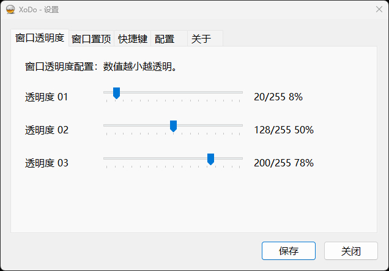
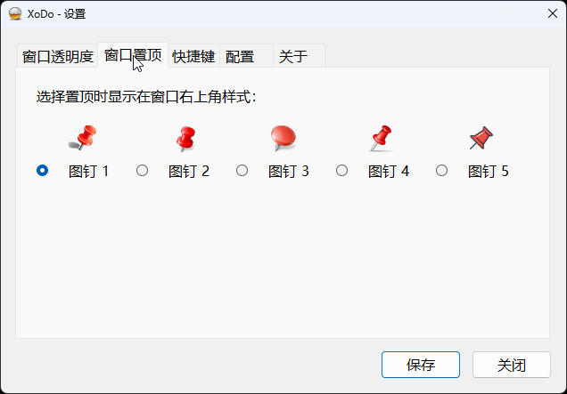
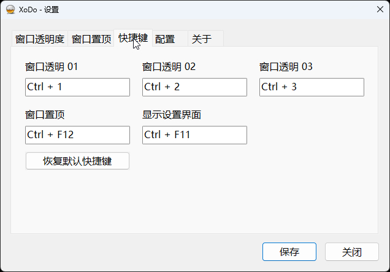
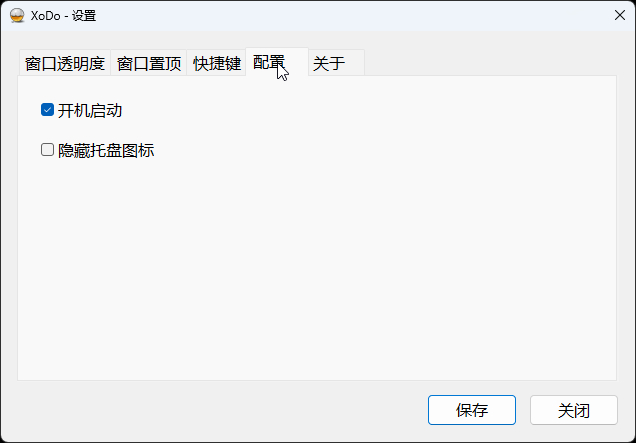
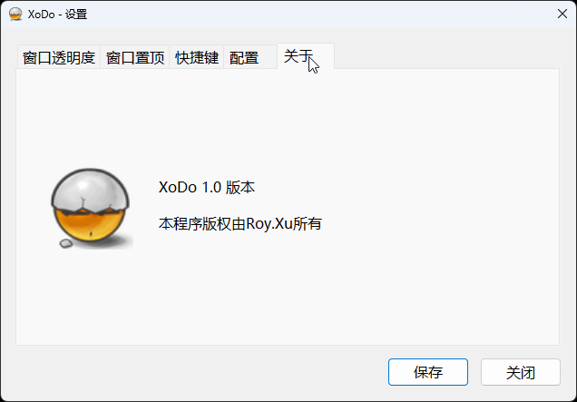

# XoDo 让任意窗口，透明可控，一钉置顶。
一个常驻 Windows 系统托盘的原生窗口辅助工具。通过全局快捷键，为当前应用窗口切换三档透明度、切换置顶状态，并以图钉标记被管理的置顶窗口。

XoDo 使用 **C++17、Win32 API 和 CMake**，不依赖 Qt、Electron、浏览器或后台服务。设置界面为中文原生 Windows 控件。

## 界面

### 窗口透明度

三组滑块分别对应三项透明度快捷键。数值越小越透明，右侧百分比表示 alpha 对应的**不透明度比例**。



### 窗口置顶

五种图钉预览及单选项。选中样式后需要保存；当前已管理窗口的标记随配置更新。



### 快捷键

分别设置三档透明度、窗口置顶和打开设置的组合键。



### 配置

控制当前用户开机启动及 XoDo 自身托盘图标的显示。



### 关于

显示应用图标、版本和作者版权信息。




## 目录

- [功能概览](#功能概览)
- [快速开始](#快速开始)
- [从源码构建](#从源码构建)
- [使用指南](#使用指南)
- [配置与数据存储](#配置与数据存储)
- [整体架构](#整体架构)
- [仓库结构](#仓库结构)
- [开发与验证](#开发与验证)
- [常见问题](#常见问题)
- [兼容性与已知限制](#兼容性与已知限制)
- [版本与版权](#版本与版权)

## 功能概览

| 功能 | 说明 |
| --- | --- |
| 三档透明度 | 为前台普通应用窗口应用三组可自定义的 alpha 值 |
| 透明度恢复 | 再次触发当前正在使用的透明度预设，恢复该窗口原始分层状态 |
| 窗口置顶 | 切换 XoDo 对窗口的置顶管理；保留窗口原有的置顶状态 |
| 图钉提示 | 提供五种图钉样式；标记跟随窗口移动及 DPI 变化 |
| 全局快捷键 | 五项功能分别配置，支持留空禁用，保存时检查重复与注册冲突 |
| 系统托盘 | 双击打开设置；右键提供开机自启、设置和退出入口 |
| 开机自启动 | 通过当前用户注册表 Run 项实现，不安装服务 |
| 隐藏自身托盘 | 仅在“显示设置界面”快捷键可用时允许隐藏 |
| 单实例 | 同一 Windows 本地会话内重复启动会唤起已有实例的设置窗口 |
| 状态清理 | 正常退出时尝试恢复透明度、恢复由 XoDo 改变的置顶状态，并释放资源 |


## 快速开始

### 运行环境

- Windows 桌面环境。建议 Windows 10 1607 及以上或 Windows 11；源码直接使用 `GetDpiForWindow`、`GetSystemMetricsForDpi` 等 API，不提供旧版 Windows 的兼容回退。
- 使用与系统架构匹配的可执行文件。本文构建示例为 x64。
- 通常以普通用户运行即可；程序 manifest 为 `asInvoker`，不会自动申请管理员权限。
- 使用已编译程序时无需安装 CMake、Visual Studio 或 Node.js。

### 直接运行

如果已有本地 Release 构建产物，在仓库根目录的 PowerShell 中执行：

```powershell
Start-Process -FilePath ".\build\Release\XoDo.exe"
```

也可以在文件资源管理器中双击可执行文件。如果没有该产物，请先按下一节编译；构建目录及二进制文件不应被假定为源码分发的必备内容。

启动后程序常驻系统托盘，**不会自动展示设置窗口**。按默认的 `Ctrl+F11`、双击托盘图标，或右键托盘选择“设置”即可打开。

建议首次使用：

1. 打开设置，确认快捷键是否与其他工具冲突。
2. 在“配置”页确认是否保留开机启动，然后保存。
3. 点击需要操作的普通应用窗口，让它成为前台窗口。
4. 按 `Ctrl+2` 体验约 50% 不透明度；再按一次恢复。
5. 按 `Ctrl+F12` 开启图钉置顶管理；再按一次取消管理。

## 从源码构建

### 构建依赖

| 项目 | 要求 |
| --- | --- |
| CMake | 3.20 或以上；版本还须支持所选 Visual Studio 生成器 |
| C++ 编译器 | 支持 C++17；推荐 Visual Studio / Build Tools 的 MSVC |
| Windows SDK | Windows 10/11 SDK，包含头文件、系统导入库及 RC 资源编译器 |
| Visual Studio 工作负载 | “使用 C++ 的桌面开发”，或等价的 C++ Build Tools 组件 |
| 源码编码 | UTF-8；不要丢失或改名中文图钉资源路径 |

不需要额外下载第三方 C++ 库。系统链接库为：`user32`、`gdi32`、`shell32`、`comctl32`、`dwmapi`、`advapi32`、`ole32`。

### 方式一：CMake + Visual Studio

在仓库根目录打开可使用 CMake 的 PowerShell 或 Developer PowerShell。以下示例使用 Visual Studio 2022：

```powershell
cmake --version
cmake -S . -B build -G "Visual Studio 17 2022" -A x64
cmake --build build --config Release
Start-Process -FilePath ".\build\Release\XoDo.exe"
```

如果第一步或配置阶段失败，先解决错误，不要继续执行后续步骤。

Visual Studio 2026 对应生成器为 `Visual Studio 18 2026`，需使用支持该生成器的 CMake；可用生成器列表见 `cmake --help`。更换生成器时使用新的构建目录，避免复用不兼容缓存，例如：

```powershell
cmake -S . -B build-vs2026 -G "Visual Studio 18 2026" -A x64
cmake --build build-vs2026 --config Release
Start-Process -FilePath ".\build-vs2026\Release\XoDo.exe"
```

如果 CMake 不在 PATH，可以使用 Visual Studio 自带 CMake 的完整路径。例如，以下路径对应一种 Build Tools 安装布局，需按实际安装位置调整：

```powershell
$cmake = "C:\Program Files (x86)\Microsoft Visual Studio\18\BuildTools\Common7\IDE\CommonExtensions\Microsoft\CMake\CMake\bin\cmake.exe"
& $cmake -S . -B build-vs2026 -G "Visual Studio 18 2026" -A x64
& $cmake --build build-vs2026 --config Release
```

### 方式二：Visual Studio 打开文件夹

1. 使用具备 C++ 桌面开发组件的 Visual Studio 打开仓库文件夹。
2. 让 Visual Studio 识别根目录的 CMake 项目。
3. 选择 x64 Release 配置，构建 `XoDo` 目标。
4. 从 IDE 运行，或启动对应输出目录中的可执行文件。

IDE 的输出路径可能不同于命令行示例，以实际 CMake 配置为准。

### Debug 与分发

Debug 构建：

```powershell
cmake --build build --config Debug
Start-Process -FilePath ".\build\Debug\XoDo.exe"
```

MSVC 配置采用静态运行库：Release 使用 `/MT`，Debug 使用 `/MTd`。应用图标、五种图钉及 manifest 都嵌入 EXE；运行时不要求把源代码中的 ICO 文件单独放在 EXE 旁边。

分发优先使用 Release EXE，并保留本 README 中的运行说明。当前构建配置没有定义安装、打包或自动发布目标，不应假定存在安装器或下载发布页。

> 重新链接同一个输出文件前，请先通过托盘正常退出对应实例。Windows 会锁定运行中的 EXE，导致 `LNK1104`。不希望打断现有实例时，可用另一个构建目录验证编译。

## 使用指南

### 默认快捷键与透明度

正常首次初始化、成功解析 AppData 路径且没有自定义配置时：

| 快捷键 | 功能 | 默认值 |
| --- | --- | --- |
| `Ctrl+1` | 窗口透明度 01 | alpha 20 / 255，界面约 8% |
| `Ctrl+2` | 窗口透明度 02 | alpha 128 / 255，界面约 50% |
| `Ctrl+3` | 窗口透明度 03 | alpha 200 / 255，界面约 78% |
| `Ctrl+F12` | 窗口置顶切换 | 图钉 1 |
| `Ctrl+F11` | 显示设置界面 | 打开或激活设置窗口 |

alpha 范围为 **1–255**；255 完全不透明，越接近 1 越透明。界面百分比按 alpha / 255 四舍五入，并不是“透明程度”的百分比。

操作针对**前台应用的根窗口**，不是鼠标悬停窗口。桌面、任务栏、XoDo 自身窗口、不可见/最小化窗口及带工具窗口扩展样式的窗口会被排除。

### 透明度切换与恢复规则

- 第一次应用预设时，保存窗口原始分层样式及可读取的原始分层参数。
- 再次按当前正在使用的预设快捷键，恢复第一次操作前的状态。
- 改按另一档快捷键，会切换到另一档，并继续保留最初状态供以后恢复。
- 例如：`Ctrl+1 → Ctrl+2 → Ctrl+2` 表示应用 01、切换 02、恢复原始状态；最后一步不是回到 01。
- 在设置页拖动滑块只更新数值显示；点击“保存”后才更新配置以及已记录窗口对应的预设值。
- 对无法读取可恢复参数的独立分层绘制窗口，程序拒绝修改，避免无法安全恢复。

### 置顶与图钉

首次按置顶快捷键时，程序记录窗口原本是否置顶，然后设置 `HWND_TOPMOST` 并创建图钉浮层。

再次触发时：

- 原本非置顶的窗口恢复为非置顶。
- 原本已经置顶的窗口仍保持置顶，仅移除 XoDo 图钉及管理记录。

因此它不是强制取消所有窗口自身置顶功能的开关。

图钉在窗口标题栏右侧、通常位于标题栏按钮组左边。定位优先读取最小化按钮坐标，失败后尝试 DWM 按钮边界，再按标准标题栏尺寸估算。图钉采用透明、不激活且鼠标穿透的浮层，**不是可点击的取消置顶按钮**。

图钉跟随目标窗口移动、缩放和 DPI 变化；窗口隐藏、最小化或处于 DWM cloaked 状态时暂时隐藏标记，恢复可见后重新显示。自绘标题栏的定位可能存在偏差。

### 修改快捷键

1. 打开“快捷键”页，点击目标输入框并输入组合键。
2. 可以清空某项以禁用对应功能。
3. “恢复默认快捷键”仅重置输入框，需要“保存”才生效。
4. 保存时检查五项内部重复，并尝试注册所有非空快捷键；注册失败则拒绝候选配置并尝试恢复原快捷键。

设置窗口处于前台激活状态时，全局快捷键暂时注销，避免录入组合键时误触功能；窗口失活或关闭后恢复注册。测试窗口快捷键前，请先切回目标应用。

设置控件支持 Ctrl、Shift、Alt 修饰键。配置读取虽支持 Win 修饰位，但原生编辑控件转换逻辑不保留它；不建议通过手工配置使用 Win 组合键后再从界面保存。

### 托盘、开机启动与退出

- **双击图标**：打开设置；左键单击没有打开设置的处理逻辑。
- **右键图标**：显示“开机自启”“设置”“退出”；开机自启项带当前状态勾选。
- **隐藏图标**：在“配置”页勾选“隐藏托盘图标”并保存；仅隐藏 XoDo 自己。
- **入口保护**：设置快捷键为空或注册失败时，不允许以隐藏托盘的方式失去设置入口。
- **重复启动**：同一会话内通知现有实例打开设置，然后第二个进程退出。
- **资源管理器重启**：通过 `TaskbarCreated` 广播按配置重建托盘。
- **保存**：统一应用所有页面配置，成功后关闭设置窗口。
- **关闭**：关闭设置窗口且不保存编辑，不退出后台进程，也没有未保存确认弹窗。
- **退出**：托盘右键选择“退出”，程序尝试恢复窗口状态并清理资源。

## 配置与数据存储

### 存储位置

配置文件位于当前用户 Roaming AppData：

```text
%APPDATA%\XoDo\settings.ini
```

不是 EXE 同目录的便携配置。配置只保存预设和选项；目标窗口句柄、原始透明度和置顶记录仅保存在进程内存中，重启后不会重新应用到这些窗口。

### INI 示例

以下展示正常默认配置的结构，数值为十进制；实际文件节/键顺序可能不同：

```ini
[Window]
Alpha01=20
Alpha02=128
Alpha03=200
PinStyle=0

[Hotkeys]
Mod1=2
Key1=49
Mod2=2
Key2=50
Mod3=2
Key3=51
Mod4=2
Key4=123
Mod5=2
Key5=122

[Tray]
HideOwn=0

[App]
Initialized=1
```

| 配置项 | 含义 |
| --- | --- |
| `Alpha01` / `Alpha02` / `Alpha03` | 三档 alpha，有效范围 1–255；读取越界值时分别回退为 20、128、200 |
| `PinStyle` | 图钉索引 0–4，对应界面图钉 1–5；越界回退为 0 |
| `Mod1`…`Mod5` | 修饰键位掩码：Alt=1、Ctrl=2、Shift=4、Win=8；多个修饰键按位或 |
| `Key1`…`Key5` | Windows 虚拟键码；0 表示该项禁用；1–5 顺序与快捷键表一致 |
| `HideOwn` | 0 显示自身托盘，非零表示请求隐藏，最终受入口保护规则约束 |
| `Initialized` | 首次初始化标记；0 或缺失会触发尝试默认启用开机自启动 |

建议通过设置界面修改。需要手工修改时先正常退出，备份 INI，再编辑并启动；运行中修改不会自动重新加载，下一次界面保存可能覆盖手工改动。

检测到旧四项热键配置（已有 `Key1` 且没有 `Key5`）时，会把旧第 3 项映射为置顶、旧第 4 项映射为设置，并为新增透明度 03 使用默认快捷键。

### 自启动注册表

当前用户登录自启动通过以下位置保存：

```text
HKEY_CURRENT_USER\Software\Microsoft\Windows\CurrentVersion\Run
值名：XoDo
类型：REG_SZ
内容：带双引号的当前 EXE 完整路径
```

### 关键数据流

1. **启动**：取得会话级命名互斥量 → 初始化 Common Controls/COM → 创建隐藏顶层窗口及图钉管理器 → 读取 INI 和自启动状态 → 首次初始化 → 注册热键 → 更新托盘 → 启动维护定时器 → 进入消息循环。
2. **窗口操作**：热键消息 → 取得前台根窗口并过滤 → 透明度记录/恢复，或图钉置顶切换 → 刷新标记。
3. **保存设置**：读取各页面候选配置 → 检查范围和重复 → 试注册新热键 → 检查隐藏托盘前提 → 更新自启动 → 更新内存与 INI → 刷新托盘、已记录窗口透明度及图钉。
4. **图钉维护**：窗口位置事件通过 `PostMessageW` 合并刷新请求；250 ms 定时器补充处理最小化、销毁或漏掉的事件。实际刷新由主线程执行，不是独立渲染线程。
5. **正常退出**：停止定时器 → 关闭设置 → 注销 WinEvent 并恢复图钉管理状态 → 恢复透明度 → 注销热键 → 删除托盘 → 释放图标、COM 和互斥量。

### 状态与资源设计

- 透明度状态表以 `HWND` 为键，保留原分层样式、色键、alpha、flags 及当前预设编号。
- 图钉状态表以目标 `HWND` 为键，保存浮层窗口、原置顶状态、DPI 和样式索引。
- 图钉基准尺寸为 24 px / 96 DPI，按目标窗口 DPI 缩放；只在 DPI 或样式改变时重新渲染。
- 图钉通过 32 位 DIB 和逐像素 alpha 合成；对缺少 alpha 通道的旧 ICO 兼容使用 AND mask。
- 隐藏主窗口是顶层窗口而不是 message-only window，以接收 Explorer 重启广播。
- 互斥量名称为 `Local\Roy.XoDo.SingleInstance`，不是跨所有用户会话的全局实例锁。

## 仓库结构

```text
XoDo/
├── CMakeLists.txt       # C++17 / Windows 构建、系统链接库与 MSVC 选项
├── Main.cpp             # 启动、消息循环、托盘、热键、透明度与持久化
├── Settings.cpp         # 原生设置窗口、五页控件、DPI 布局与保存
├── AppConfig.h          # 共享配置、默认快捷键、消息/资源 ID 与接口
├── PinManager.h         # 图钉管理类和状态定义
├── PinManager.cpp       # 置顶管理、浮层渲染、跟随定位与清理
├── XoDo.rc              # 图标、Manifest 与版本资源
├── XoDo.manifest        # 普通权限、Common Controls v6、DPI 和系统声明
├── ico.ico              # 应用图标
├── pushpin/
│   ├── 图钉1.ico
│   ├── 图钉2.ico
│   ├── 图钉3.ico
│   ├── 图钉4.ico
│   └── 图钉5.ico
├── docs/
│   └── screenshots/     # README 使用的五张真实界面截图
├── README.md
```

主要实现入口：

- [Main.cpp](Main.cpp)：`wWinMain`、`MainProc`、`ToggleTransparency`、`ApplyAppConfig`。
- [Settings.cpp](Settings.cpp)：`ShowSettings`、`CreateControls`、`SaveSettings` 与页面布局。
- [PinManager.cpp](PinManager.cpp)：`Initialize`、`Toggle`、`Render`、`Refresh`、`Shutdown`。
- [AppConfig.h](AppConfig.h)：配置默认值及模块接口。
- [CMakeLists.txt](CMakeLists.txt)、[XoDo.rc](XoDo.rc)、[XoDo.manifest](XoDo.manifest)：构建、资源和应用声明。

## 开发与验证

### 构建设置

- CMake 工程版本：`1.0.0`。
- 构建目标：`XoDo`，Windows GUI 子系统，无控制台主界面。
- 编译宏：`UNICODE`、`_UNICODE`、`NOMINMAX`、`WIN32_LEAN_AND_MEAN`、`_WIN32_WINNT=0x0A00`。
- MSVC 使用 `/W4`、`/utf-8`、`/permissive-`。
- 使用资源文件提供 manifest，MSVC 链接关闭自动生成 manifest，避免重复。
- 非 Windows 平台在配置阶段直接报错。


## 常见问题

### 启动后没有窗口，是不是没有运行？

这是正常行为。查看系统托盘及折叠图标区域，按 `Ctrl+F11`，或再次启动 EXE 唤起设置。如果快捷键已被用户修改，应使用修改后的组合键。

### 快捷键没有效果？

先确认目标普通应用处于前台，且设置窗口没有处于激活状态。启动时如提示快捷键注册失败，通常是其他软件占用或组合键无效；通过托盘打开设置换一个组合键。不要在 XoDo 设置窗口、桌面或任务栏上测试窗口操作。

### 按置顶快捷键后，窗口为什么仍然置顶？

如果目标窗口原本就置顶，XoDo 移除管理时会保留原状态。请使用目标程序自己的置顶开关取消它的原始置顶设置。

### 图钉能点击取消吗？

不能。它是鼠标穿透、不激活的视觉标记，使用置顶快捷键切换。自绘标题栏窗口可能需要额外的定位兼容性测试。

### 已经移动 EXE，开机启动为什么失效？

Run 项仍指向旧文件路径。运行新位置的 EXE，在设置中重新开启自启动并保存。启用检测要求注册表路径严格匹配当前 EXE。

### CMake 或 C++ 编译器找不到？

确认安装 C++ 桌面开发工作负载及 Windows SDK。使用 Developer PowerShell，或者将正确 CMake 加入 PATH / 使用其完整路径。CMake 配置还需要资源编译器，而不是只有 C++ 编译器。

### 构建报 `LNK1104`，无法打开 XoDo.exe？

最常见原因是同一路径的 EXE 正在运行。先使用托盘“退出”，再构建；或者指定新的构建目录。若仍失败，检查输出目录权限及文件占用。

### 修改设置后下次启动没有保留？

请区分“保存”和“关闭”，并留意配置保存失败提示。检查 `%APPDATA%\XoDo` 写入权限。当前实现中 INI 写入失败会提示，但可能仍让本次内存配置生效并关闭设置，因此需要验证重启后的结果。

### 强制结束程序后窗口状态没有恢复？

任务管理器强制结束、崩溃等情形不会执行正常清理。重新启动 XoDo 不会从磁盘找回这些窗口的原状态；可用目标应用自己的设置恢复，必要时在保存工作后关闭并重新打开目标应用。
